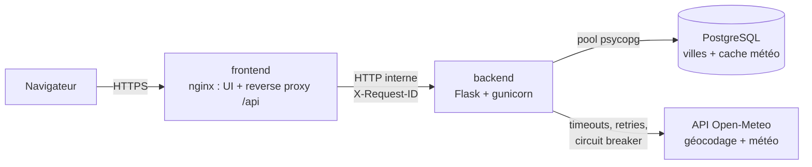
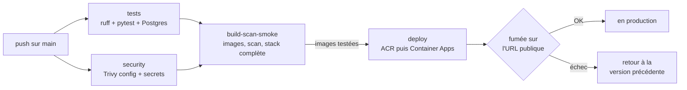

# Météo des villes — application 3 tiers sur Azure

Petite application « production-ready » : on ajoute des villes, l'application affiche leur météo actuelle.
Trois services conteneurisés — **frontend** (nginx), **backend** (Flask) et **base de données** (PostgreSQL) —
et une **API externe** (Open-Meteo) traitée comme une dépendance qui peut tomber.

> Déployée sur Azure Container Apps (frontend public, backend interne) avec PostgreSQL managé.
> Chaque push sur `main` est testé puis déployé automatiquement par GitHub Actions.

## Architecture



| Service | Rôle | Exposé |
|---|---|---|
| `frontend` | Sert l'UI statique, relaie `/api/*` au backend, pose les en-têtes de sécurité et le `X-Request-ID` | Oui (seul point d'entrée) |
| `backend` | API REST, logique de cache et de mode dégradé, migrations au démarrage | Non (interne) |
| `db` | Villes suivies et dernière météo connue | Non |

## Lancer en local

Prérequis : Docker avec Docker Compose.

```bash
cp .env.example .env        # puis changer POSTGRES_PASSWORD
docker compose up --build   # http://localhost:8080
```

Le backend applique les migrations SQL au démarrage, puis lance gunicorn.

## CI/CD et déploiement



- **Une pull request** passe par les trois premiers jobs ; **un push sur `main`** est en plus déployé.
- **On déploie exactement ce qui a été testé** : les images construites et testées par `build-scan-smoke` sont
  transmises au job `deploy` (artefact), elles ne sont pas reconstruites.
- **Image = commit** : les images portent le SHA du commit, et `/api/info` renvoie cette version. Le test de
  fumée vérifie que l'URL publique sert bien le nouveau commit.
- **Zéro interruption** : en mode révision unique, Container Apps garde l'ancienne révision tant que la
  nouvelle n'a pas passé ses sondes. Backend d'abord (il applique les migrations), frontend ensuite.
- **Retour arrière automatique** : si une révision ne démarre pas ou si le test de fumée échoue, le job remet
  les images qui tournaient avant. Retour arrière manuel :
  `az containerapp update -n meteo-backend -g rg-sre-meteo --image acrsremeteokoussay.azurecr.io/meteo-backend:<sha>`.
- **Aucun secret Azure dans GitHub** : connexion par OIDC (fédération d'identité). GitHub présente un jeton
  signé « dépôt koussayMed/Sre-SG-Medkoussay, environnement production », qu'Azure échange contre un accès de courte
  durée. L'identité du pipeline a seulement `AcrPush` sur le registre et `Contributor` sur le groupe de
  ressources de l'application. Les trois valeurs stockées dans GitHub (`AZURE_CLIENT_ID`, `AZURE_TENANT_ID`,
  `AZURE_SUBSCRIPTION_ID`) sont des identifiants, pas des mots de passe.
- **Pas de déploiements concurrents** : un seul déploiement à la fois, et un push sur `main` n'annule jamais
  un déploiement en cours.

Mise en place (une fois, depuis le poste) :

1. `infra/azure-setup.ps1` crée l'infrastructure (registre, PostgreSQL, Container Apps, Log Analytics) et
   le premier déploiement. Le mot de passe de la base est généré et stocké seulement en secret Container Apps.
2. `infra/github-oidc-setup.ps1` crée l'identité du pipeline et la confiance envers le dépôt GitHub, puis
   affiche les trois valeurs à ajouter dans les secrets du dépôt.

## API

| Méthode et route | Rôle | Codes |
|---|---|---|
| `GET /api/weather` | Les villes du visiteur **avec** leur météo, en un appel (utilisé par l'UI) | 200, 400, 503 |
| `GET /api/weather/here?lat=&lon=` | Météo à la position du visiteur (coordonnées arrondies à ~1 km) | 200, 400, 503 |
| `GET /api/cities` | Villes du visiteur | 200, 400, 503 |
| `GET /api/geocode?q=sf` | Suggestions pendant la saisie (8 max, avec région pour les homonymes) | 200, 400, 503 |
| `POST /api/cities` `{"name": "Lille", "id": 2998324}` | Ajoute la ville à la liste du visiteur. `id` (facultatif) = la suggestion choisie ; sans `id`, premier résultat du géocodage | 201, 400, 404, 409, 503 |
| `DELETE /api/cities/{id}` | Retire la ville de la liste du visiteur | 204, 400, 404 |
| `GET /api/cities/{id}/weather` | Météo actuelle d'une ville | 200, 404, 503 |
| `GET /api/info` | Version, environnement, réplica et révision qui répondent | 200 |
| `GET /healthz` | Liveness : le processus répond (aucune dépendance testée) | 200 |
| `GET /readyz` | Readiness : la base répond (+ état du circuit et du pool de connexions) | 200, 503 |

Les erreurs sont en JSON : `{"error": "<code>", "message": "...", "request_id": "..."}`.

**Listes par visiteur.** Les routes de liste attendent l'en-tête `X-Visitor-Id` : un UUID généré par le
navigateur et gardé dans son `localStorage`. Il sépare les listes sans compte utilisateur ; ce n'est pas une
authentification. Les **lieux** et leur **cache météo** restent partagés : si 100 visiteurs suivent Paris, il n'y
a qu'une ligne « Paris » en base et un seul appel à l'API météo par période.

**Météo à la position.** Le navigateur demande l'accord du visiteur (géolocalisation), arrondit les coordonnées à
0,01° (environ 1 km) avant de les envoyer, et le backend les arrondit à nouveau. Elles ne sont ni enregistrées en
base ni écrites dans les logs (nginx et Flask ne journalisent que le chemin, sans les paramètres). La météo est
mise en cache 10 minutes en mémoire par coordonnées arrondies : les visiteurs proches partagent l'entrée.

**Suggestions.** Le front attend 250 ms après la dernière frappe, annule la requête précédente et garde les
réponses de la session en mémoire. Côté backend, trois niveaux, du plus rapide au plus coûteux :
cache mémoire du processus → **cache partagé en base** (`geocode_cache`, 24 h) → Open-Meteo. Un **seul appel à
la fois par texte** et par processus : 50 requêtes simultanées pour « par » attendent le résultat du premier
appel au lieu d'appeler l'API 50 fois. API indisponible : on sert le dernier résultat connu, même expiré.
Le géocodage d'Open-Meteo ne renvoie que les correspondances exactes pour 2 lettres et fait une recherche
approchée dès 3 : l'interface l'indique. À l'ajout, le backend ne fait jamais confiance aux coordonnées
envoyées par le navigateur : il retrouve la suggestion par son `id` dans la réponse d'Open-Meteo (en cache).

**Panneau technique.** Ajouter `?tech` à l'URL affiche un bloc caché aux visiteurs : version, réplica qui
répond, et un bouton qui envoie 20 requêtes puis compte les réponses par réplica (utile pour montrer le scale-out).

**Cache navigateur.** nginx sert `index.html`, le JS et le CSS avec `expires -1` (revalidation par ETag à
chaque chargement, réponse 304 si rien n'a changé) : après un déploiement, aucun visiteur ne garde l'ancien
JavaScript face à une nouvelle API.

Chaque météo indique sa `source` :

| `source` | Signification |
|---|---|
| `cache` | Cache valide (moins de 10 min) : aucun appel externe |
| `live` | Cache expiré, rafraîchi à l'instant par cette instance |
| `refreshing` | Cache expiré, une autre instance est déjà en train de le rafraîchir : on sert la dernière valeur |
| `stale` | Rafraîchissement impossible (API en panne, circuit ouvert ou budget de temps épuisé) : dernière valeur connue |

## Choix techniques

- **Le front est statique, servi par nginx**, qui fait aussi reverse proxy : un seul point d'entrée public,
  pas de CORS, backend non exposé, en-têtes de sécurité et `X-Request-ID` posés à l'entrée.
- **Corrélation de bout en bout** : nginx génère (ou reprend) le `X-Request-ID`, le backend le réutilise dans
  tous ses logs et dans les réponses d'erreur. Les deux services loguent en JSON sur stdout.
- **L'API externe est une dépendance fragile**, donc protégée :
  - timeouts courts (connexion 1,5 s, lecture 2,5 s) ; 2 retries sur erreurs de connexion et 5xx seulement
    (pas sur timeout de lecture, qui doublerait la latence, ni sur 429, qui aggraverait le quota) ;
  - circuit breaker : après 3 échecs consécutifs, plus d'appel pendant 30 s, échec immédiat. **Un disjoncteur
    par API** (géocodage, météo) : des refus sur les suggestions ne bloquent pas le rafraîchissement météo ;
  - cache en base (10 min) : moins de latence et de quota consommé ;
  - mode dégradé : API en panne → on sert la dernière météo connue, marquée `stale`.
- **Tenue en charge** (voir [Scalabilité](#scalabilité)) : endpoint agrégé sans N+1, bail anti-rafale en base,
  budget de temps par requête, budget de connexions à la base.
- **Sondes distinctes** : `/healthz` ne teste rien d'externe (sinon une panne de la base ferait redémarrer
  tous les réplicas en boucle) ; `/readyz` teste la base ; l'API météo n'est pas dans la readiness car son
  absence est gérée par le mode dégradé.
- **Migrations versionnées** (`backend/app/migrations/*.sql`) appliquées au démarrage, protégées par un verrou
  consultatif Postgres pour que plusieurs réplicas puissent démarrer en même temps.
- **Pool de connexions borné** : une base saturée ou injoignable donne un 503 rapide plutôt qu'un blocage.
- **Configuration 12-factor** : tout par variables d'environnement ; secrets dans `.env` (ignoré par git) en local.
- **Conteneurs non-root** : utilisateur `10001` pour le backend, image `nginx-unprivileged` pour le front.

## Scalabilité

Front et backend sont **sans état** (tout est dans PostgreSQL) : on ajoute des réplicas sans changer le code.
Ajouter des réplicas déplace le goulot vers la base et l'API externe ; trois mécanismes les protègent.

**1. Budget de connexions à la base.** Chaque réplica backend ouvre au plus
`GUNICORN_WORKERS × DB_POOL_MAX_SIZE` connexions (2 × 2 = 4 par défaut). Il faut garder :

```
max_réplicas × connexions_par_réplica  ≤  connexions_utilisateur_de_la_base − marge (migrations, admin)
```

| Offre Azure PostgreSQL | Connexions utilisateur | Réplicas backend max (4 connexions chacun, marge de 3) |
|---|---|---|
| Burstable B1ms | 35 | 8 |
| Burstable B2s | 414 | 100+ (la limite devient le CPU de la base) |

Le plafond de réplicas de l'autoscaling doit respecter ce calcul : sinon, scaler *casse* l'app (connexions
refusées) au lieu de l'aider. Sur l'offre Burstable, le pooler PgBouncer intégré d'Azure n'est pas disponible.
Pourquoi 2 connexions pour 4 threads : les requêtes SQL durent quelques millisecondes, un thread attend
rarement. La saturation se voit dans `/readyz` → `info.db_pool.requests_waiting`.

**2. Pas de N+1.** L'UI appelle `GET /api/weather` : une seule requête SQL (jointure villes + cache) pour
toutes les villes, au lieu de 1 + N appels HTTP et 2N requêtes SQL.

**3. Anti-rafale à l'expiration du cache.** Sans protection, quand le cache d'une ville expire sous charge,
toutes les requêtes simultanées (sur tous les réplicas) appellent Open-Meteo en même temps. Ici, la première
prend un **bail** de 10 s par un `UPDATE` atomique en base ; les autres servent la dernière valeur
(`refreshing`). Résultat : un appel externe par ville et par période de 10 min, quelle que soit la charge.
Si l'instance qui a le bail plante, le bail expire seul.

**Budget de temps par requête.** `/api/weather` arrête de rafraîchir après 4 s (`REFRESH_BUDGET_S`) et sert le
cache, même expiré : la requête reste sous le timeout de nginx (15 s) même si l'API météo est lente.

## Test de charge et autoscaling

**Règles de scaling** (HTTP, par nombre de requêtes simultanées par réplica) :

| Service | Réplicas | Seuil de scale-out | Pourquoi |
|---|---|---|---|
| `meteo-backend` | 1 → 8 | 10 requêtes en cours | 2 workers × 4 threads = 8 requêtes traitées en parallèle par réplica ; plafond de 8 = budget de connexions PostgreSQL |
| `meteo-frontend` | 1 → 5 | 50 requêtes en cours | nginx est léger : il sert les fichiers statiques et relaie l'API |

`min-replicas = 1` : pas de démarrage à froid pour le premier visiteur. Après la charge, Container Apps retire
les réplicas en trop au bout d'environ 5 minutes.

**Scénario** (`loadtest/charge.js`, [k6](https://grafana.com/docs/k6/)) : 30 s d'échauffement, montée à 100
utilisateurs virtuels en 2 min, plateau de 4 min, descente. Parcours d'un visiteur : 70 % liste météo
(`/api/weather`), 15 % suggestions, 10 % page d'accueil, 5 % `/api/info`. Les requêtes portent sur 8 villes :
grâce aux caches, Open-Meteo reçoit au plus quelques dizaines d'appels pendant tout le test.

**Objectifs** (seuils k6, le test échoue s'ils ne sont pas tenus) : moins de 1 % d'erreurs, 95 % des listes
météo en moins de 1,5 s.

```powershell
# Terminal 1 : nombre de réplicas toutes les 10 s
powershell -ExecutionPolicy Bypass -File .\loadtest\watch-replicas.ps1

# Terminal 2 : la charge (Docker suffit, k6 n'a pas besoin d'être installé)
docker run --rm -p 5665:5665 -v "${PWD}\loadtest:/scripts" `
  -e BASE_URL=https://meteo-frontend.bluemeadow-0d1feb28.francecentral.azurecontainerapps.io `
  -e K6_WEB_DASHBOARD=true -e K6_WEB_DASHBOARD_EXPORT=/scripts/results/rapport.html `
  grafana/k6:2.3.0 run --summary-export=/scripts/results/resume.json /scripts/charge.js
```

Pendant le test : tableau de bord k6 en direct sur http://localhost:5665, réplicas dans le terminal 1, et dans
le portail Azure, **meteo-backend → Monitoring → Metrics → Replica Count** (agrégation Max). Après le test :
rapport HTML et résumé JSON dans `loadtest/results/`.

### Résultats

**Test n° 1 (23 octobre)** : environ **645 requêtes/s** en pointe, **58 ms** de temps de réponse moyen,
mais **2 % d'erreurs** (objectif : < 1 %). Les logs (requête ci-dessous) ont montré que presque toutes venaient
de `/api/geocode` : 503 `weather_api_unavailable`, circuit breaker ouvert 53 fois. La météo, elle, a tenu
(17 erreurs `/api/weather` au moment des ajouts de réplicas, soit environ 0,007 %).

Cause : à chaque scale-out, le nouveau réplica démarrait avec un cache de suggestions vide, et toutes les
requêtes simultanées pour le même texte appelaient Open-Meteo en parallèle (8 réplicas × 2 processus). Ces
rafales déclenchaient les limites de l'API ; un échec n'étant pas mis en cache, le phénomène s'entretenait.
C'est l'effet « ruée » déjà traité pour la météo par le bail en base, mais pas pour les suggestions.

Correction : un seul appel à la fois par texte, cache partagé en base entre réplicas, résultat expiré servi
si l'API refuse, et un disjoncteur séparé pour le géocodage. Tests de non-régression dans
`backend/tests/test_suggestions.py` (30 requêtes simultanées → 1 seul appel à l'API).

**Test n° 2 (24 octobre, après correction)** : objectifs tenus.

| Mesure | Test n° 1 | Test n° 2 |
|---|---|---|
| Requêtes (charge max : 100 utilisateurs virtuels) | ~ 645/s en pointe | 222 100 au total, 519/s en moyenne |
| Erreurs | 2 % | **0,0 %** |
| Vérifications k6 | — | 100 % |
| Temps de réponse moyen | 58 ms | 47 ms |
| p95 / p99 | — | 161 ms / 345 ms |
| Maximum | — | 2 s (pendant un ajout de réplica) |
| Réplicas pendant la charge | — | **8 backend / 5 frontend** (les plafonds), contre 1 / 1 au repos |

Retour à 1 réplica environ 5 minutes après la fin de la charge (relevé `watch-replicas.ps1` : 8 / 5 jusqu'à
15:06:55, puis 1 / 3 à 15:07:09 et 1 / 1 à 15:07:53). Le backend a atteint son plafond de 8 réplicas sans
aucune erreur : le plafond, calé sur le budget de connexions PostgreSQL, a protégé la base. Au-delà de cette
charge, la prochaine étape serait une offre PostgreSQL supérieure, puis un plafond de réplicas relevé.

Erreurs par service, code et route (Log Analytics, **cae-sre-meteo → Logs**, mode KQL) :

```kusto
ContainerAppConsoleLogs_CL
| where TimeGenerated > ago(4h)
| extend e = parse_json(Log_s)
| where toint(e.status) >= 400 or tostring(e.level) in ("WARNING", "ERROR")
| summarize nb = count() by app = ContainerAppName_s, status = toint(e.status), message = tostring(e.message),
    erreur = tostring(e.error), path = tostring(e.path)
| order by nb desc
```

Requêtes par réplica pendant le test (Log Analytics, **cae-sre-meteo → Logs**) :

```kusto
ContainerAppConsoleLogs_CL
| where TimeGenerated > ago(30m) and ContainerAppName_s == "meteo-backend"
| extend entry = parse_json(Log_s)
| where entry.message == "request completed"
| summarize requetes = count() by bin(TimeGenerated, 30s), replica = ContainerGroupName_s
| render timechart
```

## Observabilité et alertes

**Logs.** Les deux services écrivent une ligne JSON par événement sur stdout. Container Apps les envoie dans
Log Analytics (table `ContainerAppConsoleLogs_CL`). Chaque requête porte un `request_id` : nginx le génère (ou
le reprend), Flask le réutilise dans tous ses logs (accès, appels à Open-Meteo, erreurs) et le renvoie dans
l'en-tête `X-Request-ID` et dans les réponses d'erreur. On suit donc une requête de bout en bout.
Les coordonnées des visiteurs ne sont jamais journalisées.

**Métriques.** Celles de la plateforme (requêtes par code HTTP, réplicas, redémarrages, CPU et mémoire ;
connexions et CPU de PostgreSQL), plus l'état interne exposé par `/readyz` : disjoncteurs et saturation du pool
de connexions (`requests_waiting`).

**Requêtes prêtes à l'emploi** dans [`observability/requetes.kql`](observability/requetes.kql) (portail :
**cae-sre-meteo → Logs**, mode KQL) : taux d'erreur vu des utilisateurs, latence p50/p95/p99 par route, erreurs
par service et route, suivi d'une requête par son `request_id`, appels à Open-Meteo par résultat, mécanismes de
résilience (circuit ouvert, mode dégradé), charge par réplica, démarrages et migrations.

**Alertes** (`infra/alerts-setup.ps1 -Email ...`, Azure Monitor, envoi par email) :

| Alerte | Condition | Sévérité | Ce qu'elle signale |
|---|---|---|---|
| `meteo-5xx-utilisateurs` | plus de 10 réponses 5xx en 5 min sur le frontend | 1 | les utilisateurs voient des erreurs |
| `meteo-backend-plafond-replicas` | backend à 8 réplicas pendant 15 min | 2 | capacité : la base devient le goulot |
| `meteo-backend-redemarrages` | plus de 3 redémarrages en 15 min | 2 | plantages ou sondes en échec |
| `meteo-postgres-connexions` | 30 connexions actives ou plus | 2 | budget de connexions presque épuisé (limite 35) |

On alerte sur ce que vivent les utilisateurs (5xx) et sur les limites connues de l'architecture (plafond de
réplicas, connexions), pas sur chaque erreur isolée : une panne d'Open-Meteo, absorbée par le mode dégradé,
ne réveille personne ; elle se voit dans les logs (requête 6).

## Pannes en production : démonstration

`scripts/panne.ps1` simule les pannes sur l'environnement Azure. Dans un 2e terminal,
`.\scripts\panne.ps1 -Action etat -Suivre` affiche toutes les 5 s la version, le réplica qui répond et la
source de la météo de chaque ville.

| Action | Ce qui est simulé | Comportement attendu |
|---|---|---|
| `api-panne` | Open-Meteo injoignable (adresses `.invalid`) et cache expiré | villes affichées avec la dernière valeur (`stale`, badge dans l'UI), suggestions déjà connues servies depuis le cache partagé, ajout d'une nouvelle ville refusé proprement (503), disjoncteurs ouverts, aucune requête bloquée |
| `api-retour` | retour à la normale | disjoncteurs refermés au premier appel réussi, `live` puis `cache` |
| `bd-panne` | arrêt de PostgreSQL | page servie, météo « autour de vous » toujours disponible (n'utilise pas la base), liste → 503 en moins de 3 s (pas de blocage), alerte `meteo-5xx-utilisateurs` en quelques minutes |
| `bd-retour` | redémarrage de PostgreSQL | retour automatique, sans redémarrer le backend (le pool écarte les connexions mortes) |

Après chaque panne, la requête 6 de `requetes.kql` montre les mécanismes qui ont joué (circuit ouvert,
valeurs servies en mode dégradé, base indisponible). Toujours terminer par `api-retour` / `bd-retour` : le
pipeline ne change que l'image, une panne laissée active survivrait à un déploiement.

## Tester les pannes en local

| Scénario | Commande | Comportement attendu |
|---|---|---|
| Base arrêtée | `docker compose stop db` | `/readyz` → 503, API → 503 `database_unavailable`, UI toujours servie |
| Base redémarrée | `docker compose start db` | Retour automatique (le pool écarte les connexions mortes) |
| Backend arrêté | `docker compose stop backend` | UI servie, `/api/*` → 503 `backend_unavailable` (nginx) |
| API météo en panne | `WEATHER_CACHE_TTL_S=0 FORECAST_API_URL=https://invalid.example docker compose up -d backend` | Villes déjà en cache affichées « périmée », état du circuit visible dans `/readyz` |
| Retour à la normale | `docker compose up -d backend` | Météo `live`, circuit refermé |

## Sécurité des images

```powershell
docker compose build
powershell -ExecutionPolicy Bypass -File .\scripts\scan.ps1   # Windows
./scripts/scan.sh                                             # Linux / macOS
```

Le script lance Trivy (version épinglée) dans un conteneur et vérifie trois choses :

| Contrôle | Commande Trivy | Bloquant si |
|---|---|---|
| Vulnérabilités des images (OS + paquets Python) | `trivy image --ignore-unfixed` | HIGH ou CRITICAL **avec correctif disponible** |
| Mauvaises configurations des Dockerfiles | `trivy config` | HIGH ou CRITICAL |
| Secrets commités par erreur | `trivy fs --scanners secret` | Tout secret détecté |

Pourquoi `--ignore-unfixed` : la plupart des CVE d'une image de base sont de sévérité faible et **sans
correctif publié** ; elles ne sont pas actionnables. On bloque sur ce qu'on peut corriger, on documente le reste.
Une exception justifiée et datée va dans `.trivyignore`.

Mesures déjà prises dans les Dockerfiles : images de base `slim` / `alpine`, build multi-étapes (pas d'outils de
compilation à l'exécution), correctifs de l'OS appliqués au build (`apt-get upgrade`, `apk upgrade`), `pip`
retiré de l'image d'exécution, utilisateurs non-root, dépendances Python épinglées.

L'image `postgres:16-alpine` ne sert qu'en local : en production, la base est un service managé Azure, patché
par Microsoft.

## Tests

```bash
cd backend
python -m venv .venv && source .venv/bin/activate
pip install -r requirements-dev.txt
pytest                 # tests unitaires : sans base ni réseau (doublures)
ruff check .

# Tests d'intégration contre le Postgres de compose (base jetable : les tables sont vidées)
docker compose up -d db
TEST_DATABASE_URL=postgresql://meteo:<mot_de_passe>@localhost:55432/meteo pytest -m integration
```

## Configuration du backend

| Variable | Défaut | Rôle |
|---|---|---|
| `DATABASE_URL` | — (obligatoire) | Connexion PostgreSQL (secret) |
| `APP_VERSION` | `dev` | Version déployée (SHA git injecté au build) |
| `APP_ENV` | `local` | Nom de l'environnement |
| `LOG_LEVEL` | `INFO` | Niveau de log |
| `WEATHER_CACHE_TTL_S` | `600` | Durée de validité du cache météo |
| `HTTP_TIMEOUT_S` | `2.5` | Timeout de lecture vers Open-Meteo |
| `BREAKER_FAILURE_THRESHOLD` / `BREAKER_RESET_AFTER_S` | `3` / `30` | Réglages du circuit breaker |
| `MAX_CITIES` | `20` | Nombre maximum de villes par visiteur |
| `GUNICORN_WORKERS` / `GUNICORN_THREADS` | `2` / `4` | Concurrence par conteneur |
| `DB_POOL_MIN_SIZE` / `DB_POOL_MAX_SIZE` | `1` / `2` | Connexions par worker (voir le budget de connexions) |
| `REFRESH_LEASE_S` | `10` | Durée du bail anti-rafale |
| `REFRESH_BUDGET_S` | `4` | Temps max de rafraîchissement dans une requête `/api/weather` |

## Limites connues

- Le circuit breaker et son état sont propres à chaque processus, pas partagés entre réplicas.
- Le premier `/api/weather` après expiration rafraîchit les villes l'une après l'autre (≈ 150 ms chacune,
  plafonné par le budget de 4 s). Amélioration : rafraîchissement en tâche de fond (Container Apps Job).
- Sur une ville jamais mise en cache, deux requêtes simultanées peuvent appeler l'API (pas encore de ligne
  sur laquelle prendre le bail) : impact négligeable, une seule fois par ville.
- Pas d'authentification : l'identifiant visiteur sépare les listes mais ne protège rien. Quelqu'un qui le
  connaît voit la liste correspondante (une liste de villes, sans donnée personnelle). Amélioration : comptes
  utilisateurs (Entra ID External ID, par exemple).
- Les lieux que plus personne ne suit restent en base (taille bornée par les vrais résultats du géocodage).
  Amélioration : tâche de nettoyage périodique.
- Le cache « météo à ma position » est en mémoire, propre à chaque réplica.
- Pas de rate limiting.
- Sondes Container Apps par défaut (TCP) : un réplica reçoit du trafic dès que son port écoute. Amélioration :
  sondes HTTP `/healthz` (liveness) et `/readyz` (readiness, vérifie la base), déclarées en YAML.
- PostgreSQL joint par son adresse publique, limitée aux services Azure par le pare-feu. Amélioration :
  réseau virtuel et point de terminaison privé (offre plus chère).
- Les alertes partent par email uniquement. Amélioration : Teams ou outil d'astreinte via le groupe d'actions.
- Open-Meteo gratuit : usage non commercial, environ 10 000 appels par jour, d'où le cache.
